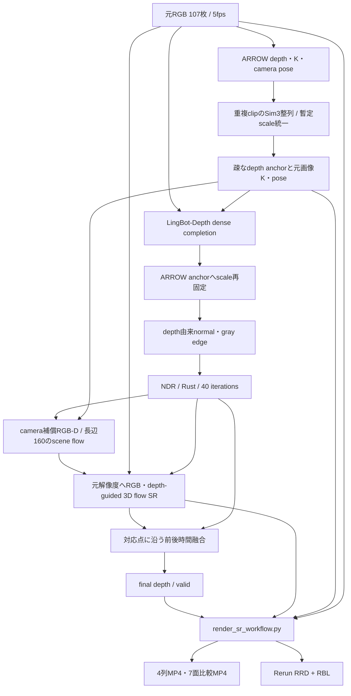

# grass SR動画・Rerunの作成手順（2026-10-16）

この文書は `grass_sr_multipanel.mp4`、`grass_sr_compare.mp4`、`grass_sr_workflow.rrd` の作り方と配布方法をまとめる。元の動きを含む深度・scene flow SRの可視化であり、後から試した静止世界やBulletTime/VACE生成の動画とは別の成果物である。

配布先は private repository [arrow-grass-sr-2026-10-16](https://github.com/yuki-inaho/arrow-grass-sr-2026-10-16)、実ファイルは [2026-10-16 release](https://github.com/yuki-inaho/arrow-grass-sr-2026-10-16/releases/tag/2026-10-16)。閲覧・取得には同リポジトリへのアクセス権が必要。

## 入力と処理の全体像

元入力は `/home/kasm-user/Downloads/grass/douga_2026-09-15_14-16-51_frames_5fps/` の107枚、各720幅×1280高、5fps。入力をPNGへ取り込んだものが `results/depth_detail_oct16/grass/frames_rgb/`、フレーム順・原入力パス・RGBのSHA256は同じディレクトリの `frames.json` にある。



| 段階 | 実装と処理 | 保存先（`results/depth_detail_oct16/grass/` 配下） |
|---|---|---|
| 取り込み・ARROW | `run_depth_detail.py` が専用workerを順番に起動。24枚clip、4枚重複を基本としてdepth/K/poseを取得 | `frames.json`, `frames_rgb/`, `stages/arrow_clips/` |
| 整列・尺度 | 重複点でclip間をSim3整列。depthとcamera translationへ同じscaleを1回適用。native画素中心Kを復元 | `stages/align/`, `stages/anchor/`, `stages/geometry/` |
| dense depth | LingBot-Depthの実checkpointを使用。疎ARROWとのrobust log ratioで尺度を再固定 | `stages/lingbot/`, `stages/lingbot_fix/` |
| refinement | 高解像度depthからnormalとgray edgeを準備し、NDRのRust backendを40反復 | `stages/prep/`, `stages/ndr/` |
| 低解像度scene flow | 次RGB-Dを現在cameraへ補償してからnative solverを実行。長辺160、独立pairは4並列 | `stages/sceneflow/` |
| scene flow SR | `arrow.depth_detail.superresolve_scene_flow` が元解像度NDR depthとRGBでjoint-bilateral補間。実solverの支持と両depthの有効性を要求 | `stages/sr/NNNNNN.npz` |
| 時間融合・確定 | SR 3D変位で対応点を運び、前後候補を共通支持領域で検査して融合 | `stages/temporal/`, `stages/final/`, `frames/NNNNNN.npz` |
| 可視化 | 保存済み確定stageを読む独立consumer。モデル推論・SR推定を再計算せずMP4/RRDへ変換 | `results/sr_static_oct16/grass/sr_visuals/` |

SRは学習済みの生成モデルではなく、境界に配慮した決定論的補間。3D変位へ画像の拡大倍率を掛けない。低解像度で観測できなかった細かな運動の真値を保証する処理ではない。MoGeはこの主経路では使用していない。

## 尺度・座標・表示の契約

- 単位は `arrow_provisional`、`metric_calibrated=false`。ユーザー指定に従い、低解像度ARROW depthを暫定尺度とした。後からdepth・camera translation・3D flowに同じ単一scalarを適用して校正する。
- depthはcamera-z。Kは元画像の整数画素中心、poseはcamera-to-worldのrigid行列。変数名 `arrow_camera_to_metric` の「metric」は校正済みメートルを意味しない。
- `sr_flow` は現在camera向きの、camera補償済み3D残差変位。点群位置にはposeの回転と並進、矢印ベクトルには回転だけを適用する。
- 表示は `(x,z,-y)` のZ-upへ1回だけ変換。native座標の点や矢印を混在させない。
- 点群の表示strideは4pixel、SR矢印は32pixel。支持率の分母は間引き点数ではなく全921,600pixel。支持maskを確率的なconfidenceとは呼ばない。
- 48本の軌跡は実SRから移流し、対応を失ったものを終了する。grassでは末尾まで残った軌跡は0本。末尾frame106は次pairがないためSR矢印を空で記録する。
- depthの全frame共通色範囲は `[1.3835518646, 7.6473661041]`、3D flow magnitudeは `[0.0037758128, 0.1331692507]`。色付きMP4から定量depthを復元せず、分析には元NPZを使う。

## 再現方法

### 保存済みdepth/SRから動画とRerunだけ作る

arrowの既存 `.venv`、Pillow/NumPy/Matplotlib/Rerun 0.39、ffmpegが必要。出力先には新しいディレクトリを使う。このconsumerは既存の同名動画を置換し得るため、元の公開物へ直接再実行しない。

```bash
cd /home/kasm-user/Desktop/arrow
.venv/bin/python scripts/render_sr_workflow.py \
  --input-dir results/depth_detail_oct16 \
  --output-dir results/sr_reproduce_2026-10-16 --dataset grass
```

短い確認には別出力先で `--max-frames 3` を追加する。manifestの `preview=true` を全107frameの結果と取り違えない。描画前に全frameの必須stage/RGBを検査し、空き35GiBとdataset出力6GiBのgateを適用する。

consumerが読む最小の確定stageは `final`, `geometry`, `sr`, `anchor`, `ndr`。7面比較のLingBot/scene-flow/temporalパネルにも各対応stageを使うため、元の `depth_detail_oct16/grass` 一式を保持する。RRD/MP4だけから深度パイプラインを再計算することはできない。

### 元RGBから深度・flowも作り直す

環境・検査の詳細は [DEPTH_DETAIL.md](DEPTH_DETAIL.md)。runnerはARROW、LingBot、NDR、scene flowの専用venvを使う。このPCではそれぞれ `arrow/.venv`、`lingbot-depth/.venv`、`normal_depth_refiner_sandbox/.venv`、`rgbd_sceneflow_sandbox/.venv`。別PCでは `scripts/run_depth_detail.py` の環境パスとCUDAライブラリの前置先を合わせる必要がある。

```bash
MODEL_CHECKPOINT='/home/kasm-user/.cache/huggingface/hub/models--robbyant--lingbot-depth-pretrain-vitl-14-v0.5/snapshots/79204ed6b837f4fdd192cf563e59481fecfa0295/model.pt'
.venv/bin/python scripts/run_depth_detail.py --dataset grass --stage all \
  --grass-dir /home/kasm-user/Downloads/grass/douga_2026-09-15_14-16-51_frames_5fps \
  --output-dir results/depth_detail_reproduce_2026-10-16 \
  --arrow-device auto --device cuda \
  --lingbot-model "$MODEL_CHECKPOINT" --lingbot-resolution-level 9 \
  --ndr-backend rust --ndr-iterations 40 --long-side 160 --sceneflow-workers 4
```

実行前のargv確認は `--dry-run`。中断後は同じ出力先と設定で再実行し、署名一致するstageを再利用する。helperの変更はstage署名を変えるため、上流再実行が必要になる場合がある。署名を手で書き換えない。ARROW native clip cacheとstage署名の再利用は別判定。

その後、最初の可視化コマンドの `--input-dir` を新しいdepth出力先へ変更する。実行したargv・モデル・設定・入力SHAは各stage metadata、`manifest.json`、`configs/stage_configs/` に残る。

## 何を開くか

| ファイル | 使い方 / 実仕様 |
|---|---|
| `grass_sr_multipanel.mp4` | 最初に見る概要。1920×1080、4列幅18/18/40/24%。RGB、2D投影したSR変位、final depth、normal、支持、点群、camera、軌跡を同時表示 |
| `grass_sr_compare.mp4` | RGB / ARROW / LingBot / NDR / Scene flow / Temporal / SR 3D flowの7面比較。1808×474 |
| `grass_sr_workflow.rrd` + `.rbl` | 視点と時刻を操作するRerun記録と初期表示設定。画像と点群はRRDに含まれ、再生には元NPZ・モデル重みが不要 |
| `grass_sr_*.png` | 動画の代表画像と実Rerun画面のプレビュー |
| `grass_sr_manifest.json` | 原manifest。全frame index、入力SHA、表示設定、尺度、範囲、支持集計。保存当時の絶対パスを含む来歴情報 |
| `artifact_manifest.json`, `SHA256SUMS` | 配布8ファイルの相対名・実bytes・SHA256。取得後の同一性確認に使う |

2本の動画はいずれもH.264、107frame、5fps、21.4秒。MP4とRRDの3ファイル合計は216,015,089 bytes。RBL・PNG3枚・原manifestを含む配布8ファイルは220,363,683 bytes（220.36MB / 210.16MiB）。配布用の小さなmanifestとSHA一覧はこの合計に含めない。

```bash
gh release download 2026-10-16 \
  --repo yuki-inaho/arrow-grass-sr-2026-10-16 --dir grass-sr
cd grass-sr
sha256sum -c SHA256SUMS
rerun grass_sr_workflow.rrd grass_sr_workflow.rbl
```

Rerun 0.39で保存・検証した。再生だけなら、同版のviewerを用意して上の2ファイルを開けばよい。通常のGit cloneやGitHubが自動生成するSource code zipには大きな動画/RRDは含まれず、release assetsから取得する。

## 表示改善、確認、残る制約

以前ARROW列が暗かったのは、疎なanchorの黒い無支持pixelも含めて縮小していたため。今回の比較は規則格子へ有効depthを集約して着色し、nearestで表示拡大する。不規則配置では有効値だけを面積加重する。数値anchorをdense推定へ変更したわけではない。

今回の配布前にrootが元8ファイルの実bytes/SHA256を取り直し、ffprobeで2動画の全107frameとfpsを確認、`rerun rrd verify` でRRD/RBLの2ファイルを確認した。以前の実行時にはRRD点・色・回転・ベクトル・frame被覆・末尾空フローの数値読み戻しと実viewer表示も検証している。

- findings: 静止世界の失敗とSR観測可視化は別の処理。配布する `sr_visuals` は各時刻の観測depth/flowを表示する。
- struggles: sparse表示の暗さ、3D表示座標の二重変換、統計のframe取り違え、末尾に前frameの矢印が残る問題を個別に修正・検査した。
- tips: まず概要MP4、次にRerunで同時刻を開く。色範囲・間引き・支持率・尺度の意味をmanifestと照合する。
- tips: RRD単体が約195MBあるため、GitHubの通常Gitの100MiB制限を避け、private repositoryのrelease assetsで配布する。[GitHub公式仕様](https://docs.github.com/en/repositories/working-with-files/managing-large-files/about-large-files-on-github)

実3Dの真値・絶対メートルは未検証。non-rigid分解と固定世界の履歴は [SR_STATIC_WORLD.md](SR_STATIC_WORLD.md)、後続生成実験の不合格理由・14B未生成での停止記録は [GUIDED_STATIC_WORLD.md](GUIDED_STATIC_WORLD.md) を参照。
